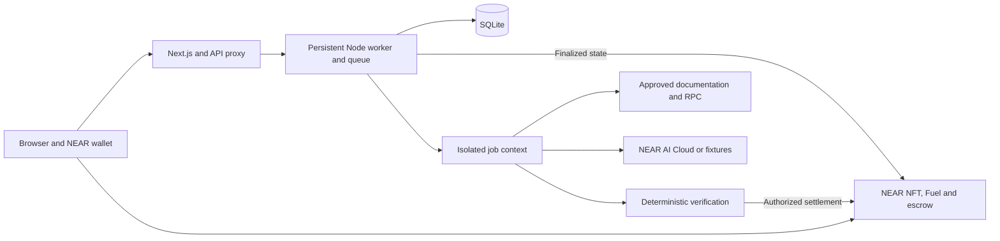

# Architecture

The customer reviews a quote before wallet signing. The worker checks the finalized signer, receiver, function, arguments and reservation against the stored request. SQLite holds offchain briefs, configurations and reports. The contract holds ownership, commitments and settlement. Locally the same job queue and verifier run against simulated accounting.

The web app can run on Vercel from `apps/web` with workspace dependencies installed from the root. Host the worker separately on persistent Node with a writable volume. Configure `PROOFBOUND_WORKER_URL` on the web host and `PROOFBOUND_WEB_ORIGIN` on the worker. Vercel Hobby terms limit use to personal or non-commercial projects. [Vercel terms](https://vercel.com/legal/terms)
